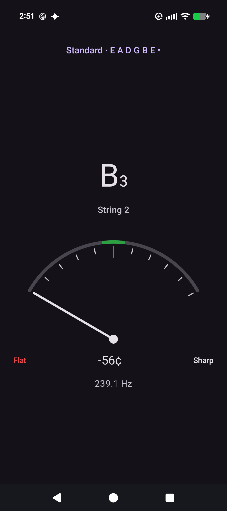
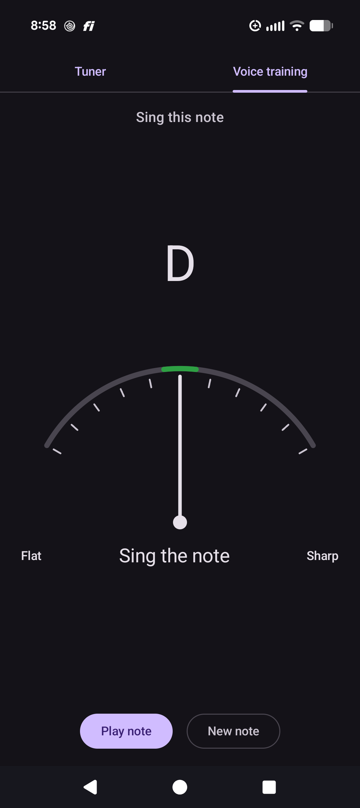

# On The Nose

On The Nose is a basic guitar tuner app with voice training.  I struggled to 
find a decent tuner app. Ads, wifi required, sign-up needed, etc.  

I figured "I can probably vibe code one up in half a day".  So, I did.  

I added something I've always wanted - a little game that allows me to train 
my voice.  It shows a note and you try to sing it.  

I hope you enjoy this!

 

## Features

- **Needle gauge** covering 50 cents flat to 50 cents sharp, with a green zone in the middle. The note and needle turn green within 5 cents of in tune, and the Flat or Sharp label turns red when the note is off on that side.
- **Tunings.** In a tuning, the tuner aims for the nearest open string and shows its number (1 is the highest-pitched string, 6 the lowest). Chromatic aims for the nearest note of any kind.

  | Tuning | Strings, low to high |
  |---|---|
  | Chromatic | any note |
  | Standard | E A D G B E |
  | Drop D | D A D G B E |
  | Half step down | D# G# C# F# A# D# |
  | Open G | D G D G B D |
  | Open D | D A D F# A D |
  | Open E minor | E B E G B E |
  | Open D minor | D A D F A D |
  | DADGAD | D A D G A D |

- **Voice training.** A second view picks a random note for you to sing and shows how close you are on the same gauge. Any octave counts, so it suits any vocal range. **Play note** sounds the target so you can hear it, and **New note** picks another.

- **Private.** Audio is analysed on the device and never recorded or sent anywhere. The app has no ads, no analytics and no internet permission. See the [privacy policy](https://davidrudder23.github.io/on-the-nose/privacy/).

## Building

You need JDK 21 and the Android SDK (platform 37, build-tools 37.0.0). Point `ANDROID_HOME` at the SDK, or put `sdk.dir=/path/to/Sdk` in a `local.properties` file at the project root.

```
./gradlew assembleDebug        # build the debug APK
./gradlew testDebugUnitTest    # run the unit tests
./gradlew installDebug         # install on a connected device
```

The debug APK is written to `app/build/outputs/apk/debug/app-debug.apk`. The app runs on Android 8.0 (API 26) and newer.

### Release build

Google Play takes a signed app bundle. Create an upload keystore, keep it outside the repository, and describe it in `~/.gradle/gradle.properties`:

```
ONTHENOSE_STORE_FILE=/path/to/upload.jks
ONTHENOSE_STORE_PASSWORD=...
ONTHENOSE_KEY_ALIAS=upload
ONTHENOSE_KEY_PASSWORD=...
```

```
./gradlew bundleRelease        # build the signed release bundle
```

The bundle is written to `app/build/outputs/bundle/release/app-release.aab`. Raise `versionCode` in `app/build.gradle.kts` before each upload. Without the properties above, the release build is left unsigned.

## How it works

- `audio/PitchDetector.kt` estimates the fundamental frequency with the YIN algorithm. It has no Android dependencies, so it is unit tested on the JVM with synthesized tones.
- `audio/PitchSource.kt` reads the microphone and emits a stream of detected pitches. The microphone is released whenever the app is in the background.
- `audio/Note.kt` and `audio/Tuning.kt` turn a frequency into the note to tune towards and the offset from it in cents.
- `audio/Tone.kt` and `audio/TonePlayer.kt` generate and play the target note for voice training.
- `ui/` holds the Jetpack Compose screens: the gauge shared by both views, the tuning picker, and voice training.

The app always opens on the tuner with the chromatic scale; it does not store any settings.

The app ID and the Kotlin package are both `org.noses.onthenose`.
